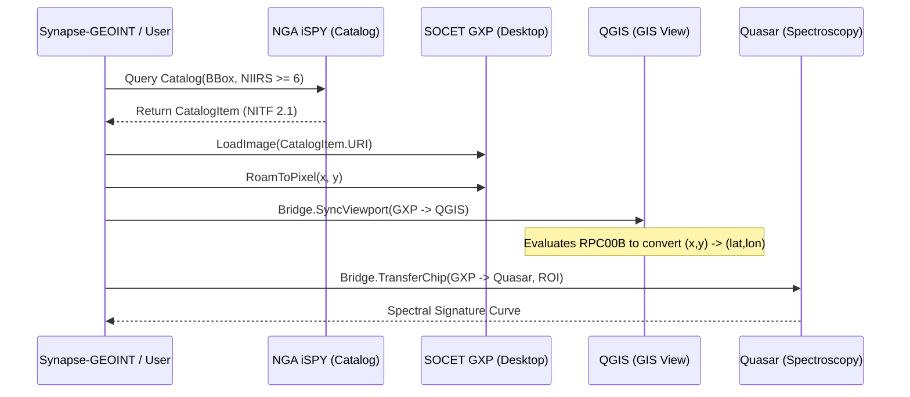

# AnyElt Architecture Specification

> **Document Identifier:** `AURA-ANYELT-ARCH-001`  
> **Runtime Baseline:** Python 3.10+ / .NET 10.0 (C# 12)  
> **Authors:** AuraCore Dynamics Engineering  

---

## 1. Architectural Philosophy

Electronic Light Tables are fundamentally specialized raster display, projection, and mensuration engines. However, commercial, defense, and open-source tools use disparate coordinate representations, communication protocols, and file formats:

| Category | Typical Platforms | Communication Model | Primary Coordinate Space |
| :--- | :--- | :--- | :--- |
| **Heavy Desktop Workstations** | BAE SOCET GXP, Textron RemoteView | COM, CLI automation, Shared Memory, File Drop | Native Sensor Array $(s, l)$ + RPC |
| **GIS Desktop GIS** | QGIS | PyQGIS, Python plugins, Socket IPC | Geodetic $(lat, lon)$ / Projected CRS |
| **Sovereign Web ELTs** | AuraMist | REST, WebSocket, AMEPS plugin, WebGL | Dual-Space (Sensor Matrix + Web Mercator) |
| **Catalog-Centric Services** | NGA iSPY, GXP Xplorer | OGC WMS/WCS, REST, CSW | Geodetic BBox $[minX, minY, maxX, maxY]$ |
| **Scientific Processing** | ImageJ / Fiji, Quasar (Orange) | Macros, Python bindings, NumPy/NDArray | Array Indexing $[C, Z, Y, X]$ |

**AnyElt** decouples exploitation consumers (e.g. Synapse-GEOINT cognitive agents, web dashboards, batch analytics pipelines) from the concrete implementation of any single light table.

---

## 2. Domain Model Taxonomy

### 2.1 Capability System (`EltCapability`)
AnyElt replaces fragile runtime discovery and trial-and-error API calls with a strongly typed **bitmask capability system**. Each adapter declares its supported operations:

```
[DirectLoading] ────► Image file path or stream ingestion
[CatalogSearch] ────► Bounding box, temporal, and sensor catalog search
[SensorRoam]    ────► Navigation in native pixel space
[GroundRoam]    ────► Navigation in WGS84 / projected CRS
[RpcProjection] ────► Rational Polynomial Camera (RPC00B) evaluation
[ChippingSensor]────► Pixel sub-matrix chip harvesting
[ChippingGround]────► Orthorectified bounding-box chip harvesting
[Hyperspectral] ────► High-dimensional data cube slicing
[ViewportSync]  ────► Real-time extent broadcasting
```

If an application attempts an operation that the target ELT does not support (e.g. calling `LoadImage` on `ISpyAdapter`, which is catalog-only), AnyElt immediately raises `UnsupportedCapabilityException` with diagnostic metadata.

---

## 3. Cross-ELT Bridging Engine

The `EltBridge` orchestrates multi-tool workflows:



---

## 4. Open-Source Extension Framework

To integrate scientific tools that lack military or geospatial standards:
1. **`ImageJGeointExtension`**:
   - Parses MIL-STD-2500C NITF headers and TREs.
   - Embeds forward/inverse RPC00B evaluation.
   - Synthesizes headless ImageJ Macro scripts (`.ijm`) to drive contrast, brightness, and chipping.
2. **`QuasarSpectralExtension`**:
   - Ingests hypercube arrays (e.g. 224-band AVIRIS).
   - Extracts mean reflectance signatures across regions of interest (ROIs).
   - Computes Spectral Angle Mapper (SAM) metric $\theta = \arccos\left(\frac{A \cdot B}{\|A\| \|B\|}\right)$ to identify materials.
